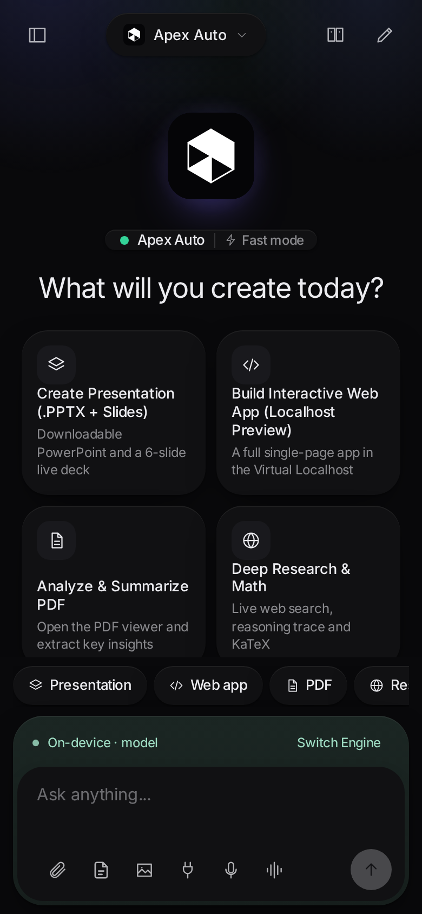
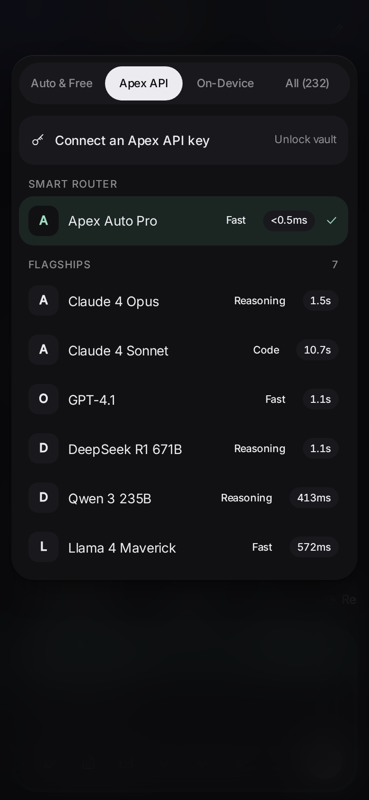
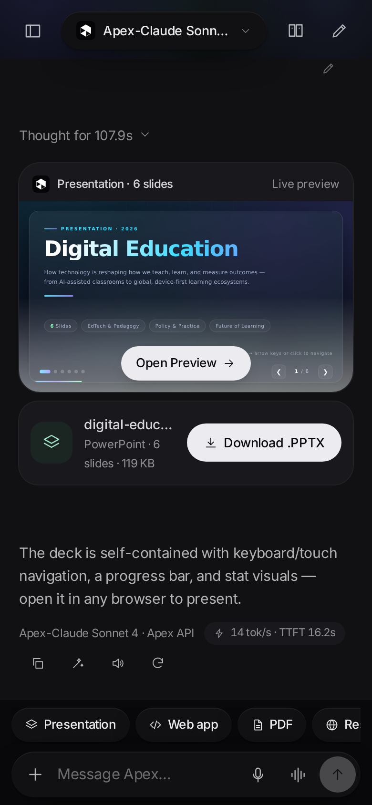
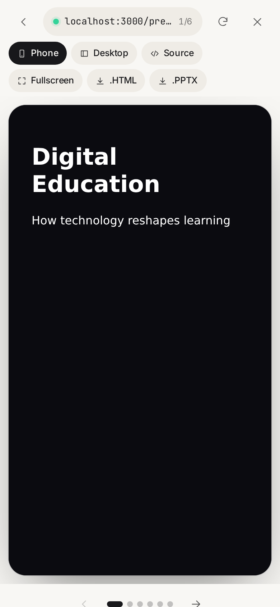
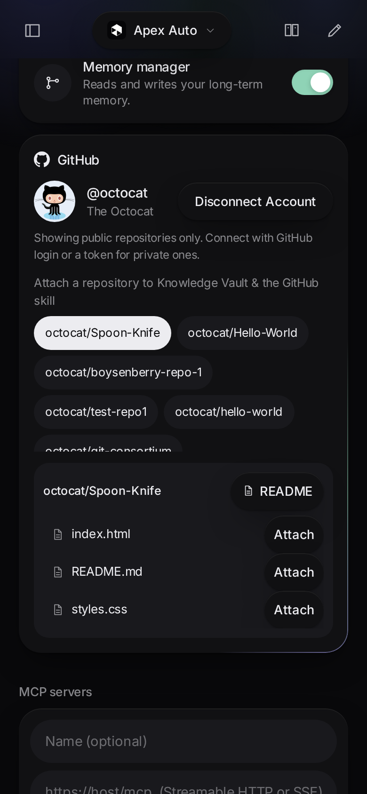
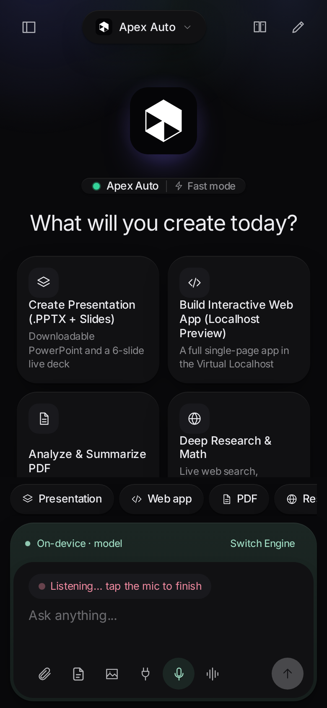

<p align="center"></p>

# Apex: On-Device Local AI Runner and Private Pocket Studio

Run open-weight GGUF models fully offline on your phone, read PDFs, build presentations and live previews, and generate artwork in one private studio. Native Rust core, Tauri v2 Mobile shell.

**Website:** https://prashantchataut.github.io/apex-llm-android/ &nbsp;|&nbsp; **Android APK:** [latest release](https://github.com/prashantchataut/apex-llm-android/releases/latest) (arm64)

**Download:** [Apex-LLM-v1.7.0-arm64-release.apk](https://github.com/prashantchataut/apex-llm-android/releases/download/v1.7.0/Apex-LLM-v1.7.0-arm64-release.apk) (signed, arm64). Source version `1.7.0`, `versionCode 18`. The web UI under `web-showcase/` is the same frontend the APK embeds.

<table><tr>
<td align="center"><br><sub>Home</sub></td>
<td align="center"><br><sub>Model Switcher</sub></td>
<td align="center"><br><sub>Live Claude 4 Sonnet deck</sub></td>
<td align="center"><br><sub>Virtual Localhost</sub></td>
<td align="center"><br><sub>GitHub browser</sub></td>
<td align="center"><br><sub>Voice input</sub></td>
</tr></table>

### What's new in 1.7.0
- **Complete replies.** Cloud requests send `max_tokens: 8192`; reasoning (`reasoning_content`, `<think>`, planning text before a code fence) goes to the collapsible Thinking Trace and the bubble shows only the final answer.
- **Model Switcher** with four tabs (Auto & Free, Apex API, On-Device, All) and one clean line per model. Free Cloud Models work with no key. `Apex Auto Pro` leads the Apex API tab.
- **Real `.pptx` export** (`pptxgenjs`) with a Download card in the chat, plus the **Virtual Localhost** live preview (Blob sandbox, reload, phone/desktop, source, downloads, auto-closes truncated HTML).
- **Voice.** Instant streaming dictation, or on-device Moonshine Tiny (about 28 MB) / Whisper tiny (about 40 MB). Read Aloud with play, pause, stop, Auto-Speak, voice and speed.
- **GitHub for anyone.** Connect by username with no token, browse repos and attach files to chat, or use a personal token for private repos and Gists. Credentials stay on the device.

### What's new in 1.6.0
- **Connect your own GitHub.** No account, token or fallback profile ships with the app. Connect with GitHub device login, a personal token (kept only in this device's `localStorage`), or any public username. One tap to disconnect.
- **Apex API key is checked live.** Every start and every request re-reads `apex-vault.json` (`no-store`) and the stored key fingerprint (`apex_unlocked_key_hash`) must still match an active key. Edit or replace the key in `/admin` and the old key stops working.
- **Keyboard-safe dialogs.** Dialogs sit in the upper half of the screen, track `visualViewport`, and scroll the focused field into view.
- **Fast Direct Mode.** Local models get a minimal prompt and stream immediately. The agent harness (tools, skill pre-runs, memory extraction) is an opt-in setting, off by default. Haptics default to Off.
- **Signature components.** Expandable `ThinkingTrace`, contextual `SelectionActionsBar`, and the full-screen `LivePreviewViewer` (phone, tablet, code, slide decks, export to PDF).
- **Home and onboarding redesign** around the Apex mark, an engine status pill and four creation cards. Prompt templates, speed and TTFT pill, in-app PDF viewer and offline KaTeX.

## What's here
| Path | What |
|---|---|
| `crates/cortex-hardware` | `/proc` + NDK profiler → `DeviceCapabilityProfile` (RAM, SoC tier, Vulkan, quant + ctx recommendation) |
| `crates/cortex-hf-hub` | Hugging Face GGUF search, ⚡/⚠️/❌ scoring, resumable segmented downloads + SHA-256 |
| `crates/cortex-inference` | `Engine` trait, streaming `<think>` parser, GBNF (MCQ/JSON), chat templates |
| `crates/cortex-voice` | `Transcriber` trait, INT8 model catalog, VAD, 60 fps spectrum bins |
| `crates/cortex-server` | axum: Ollama + OpenAI endpoints, `sk-apex-…` key vault (hashed), request log |
| `crates/cortex-integrations` | GitHub REST client + provider router (Local / OpenRouter / Anthropic / OpenAI / Groq) |
| `app-ui/src-tauri` | Tauri v2 Mobile shell (thin command layer) |
| `web-showcase` | Next.js static export: landing page **and** the 4 app screens (`/app`) |
| `packages/design-system` | Canonical design tokens (`tokens.css`) |
| `.agent/` | Memory brain for stateless AI sessions |

## Run it
```bash
# UI + landing
cd web-showcase && npm install && npm run dev        # http://localhost:3000  (app: /app)

# Rust
cargo test --workspace

```

## Design language
Four archetypes — Obsidian + aurora (A), VisionOS frosted fan-stack (B), Swiss grid + progressive-opacity type (C), reasoning chat (D). Spec in [`.agent/SKILLS_PROTOCOL.md`](.agent/SKILLS_PROTOCOL.md).

## Docs
[`ARCHITECTURE.md`](ARCHITECTURE.md) · [`RULES.md`](RULES.md) · [`PROGRESS.md`](PROGRESS.md) · [`CLAUDE.md`](CLAUDE.md)
